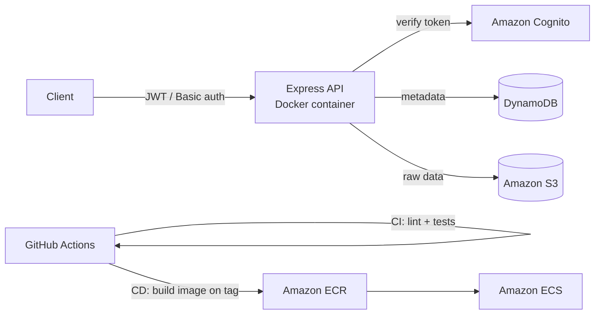

# Fragments

A cloud-native REST microservice for storing and converting small pieces of content ("fragments"): text, Markdown, HTML, JSON and images. Built with Node.js and Express, it authenticates users with Amazon Cognito, stores data in Amazon S3 and DynamoDB, runs in Docker, and ships through GitHub Actions to Amazon ECR.

I built it over one semester (Sept–Nov 2025) in a cloud computing course at Seneca Polytechnic.


## What it does

- **Authenticated, per-user storage.** Every request under `/v1` needs a Cognito JWT (production) or HTTP Basic auth (local testing). Users only ever see their own fragments, and the service stores a SHA-256 hash of each user's email instead of the email itself.
- **Content-type aware.** Accepts `text/plain`, `text/markdown`, `text/html`, `application/json`, `image/png`, `image/jpeg`, `image/webp` and `image/gif`.
- **On-the-fly conversion.** Request a fragment with a different extension and it is converted before it's returned: Markdown → HTML or plain text, HTML → plain text, JSON → formatted text, and any supported image → PNG, JPEG, WebP or GIF (using [sharp](https://sharp.pixelplumbing.com/)).
- **Swappable storage backend.** With `AWS_REGION` set, metadata goes to DynamoDB and raw data to S3. Without it, an in-memory store is used, which keeps unit tests fast and dependency-free.

## Architecture



## API

| Method | Route | Description |
|---|---|---|
| `GET` | `/` | Health check (no auth): status, version, repo link |
| `GET` | `/v1/fragments` | List your fragment IDs (`?expand=true` for full metadata) |
| `POST` | `/v1/fragments` | Create a fragment. Returns `201` with a `Location` header |
| `GET` | `/v1/fragments/:id` | Get a fragment's data |
| `GET` | `/v1/fragments/:id.:ext` | Get a fragment converted to another type (e.g. `.html`, `.png`) |
| `GET` | `/v1/fragments/:id/info` | Get a fragment's metadata |
| `PUT` | `/v1/fragments/:id` | Replace a fragment's data (type can't change) |
| `DELETE` | `/v1/fragments/:id` | Delete a fragment |

Example (local, Basic auth):

```bash
# Create a Markdown fragment
curl -i -u user1@email.com:password1 \
  -H "Content-Type: text/markdown" \
  --data "# Hello **world**" \
  http://localhost:8080/v1/fragments

# Read it back as HTML
curl -u user1@email.com:password1 http://localhost:8080/v1/fragments/<id>.html
# <h1>Hello <strong>world</strong></h1>
```

## Run it locally

Requires Node.js 22+.

```bash
npm install

# In-memory storage + Basic auth with the test users in tests/.htpasswd
HTPASSWD_FILE=tests/.htpasswd npm start
```

To run against local stand-ins for AWS (DynamoDB Local and LocalStack S3):

```bash
docker compose up -d
./scripts/local-aws-setup.sh   # creates the S3 bucket and DynamoDB table
```

## Testing and quality

```bash
npm test                  # Jest unit tests
npm run coverage          # unit tests with coverage
npm run test:integration  # Hurl integration tests (needs docker compose up)
npm run lint              # ESLint
```

## CI/CD

- **CI** (`.github/workflows/ci.yml`, on every push and pull request to `main`): ESLint, Hadolint for the Dockerfile, Jest unit tests, and Hurl integration tests against DynamoDB Local and LocalStack. When all of them pass, the image is built and pushed to Docker Hub.
- **CD** (`.github/workflows/cd.yml`, on version tags like `v0.10.3`): builds the image and pushes it to Amazon ECR, tagged with the version and `latest`. The ECS task definition is in `fragments-definition.json`.

## Project structure

```
src/
  app.js, server.js, index.js   Express app, HTTP server, entry point
  auth/                         Cognito JWT and HTTP Basic strategies
  model/fragment.js             Fragment model: validation, formats, persistence
  model/data/                   Storage backends: aws/ (S3 + DynamoDB) and memory/
  routes/api/                   One file per endpoint
tests/
  unit/                         Jest unit tests
  integration/                  Hurl integration tests
```
